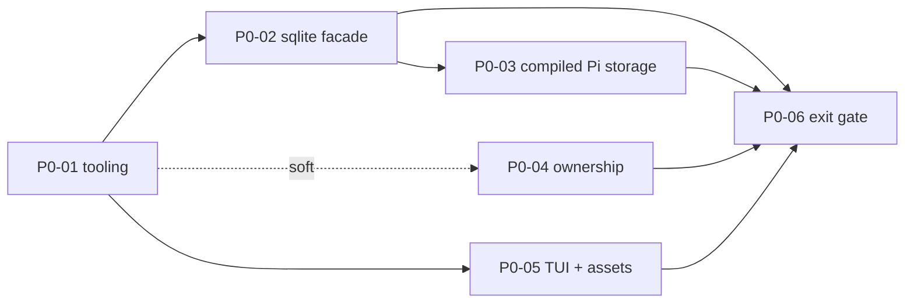
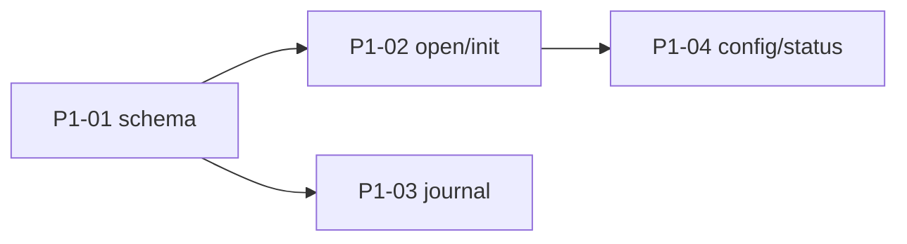

# Work board

Task index and dependency graph. **Live status lives in each task file**, not here — see it with:

```bash
grep -H -E '^(status|owner|branch):' work/tasks/*.md
```

Latest session notes: [HANDOFF.md](HANDOFF.md). Protocol: [AGENTS.md § 3](../AGENTS.md#3-multi-agent-protocol). Template: [_templates/task.md](_templates/task.md).

## Phase 0 — prove the risky runtime boundaries

Exit gate: recorded evidence picks the SQLite adapter, ownership mechanism, and terminal renderer. Nothing in Phase 1+ starts on an unproven boundary.

| ID | Task | Depends on | Parallel with |
| --- | --- | --- | --- |
| [P0-01](tasks/P0-01-tooling-baseline.md) | Pinned Bun/TS tooling baseline | — | P0-04 |
| [P0-02](tasks/P0-02-sqlite-async-facade.md) | Shared async SQLite facade + awaited rollback | P0-01 | P0-04, P0-05 |
| [P0-03](tasks/P0-03-compiled-pi-storage.md) | Compiled binary: Pi storage reopen + real file tool | P0-01, P0-02 | P0-04, P0-05 |
| [P0-04](tasks/P0-04-home-ownership.md) | Single-owner home exclusion | — (soft: P0-01) | everything |
| [P0-05](tasks/P0-05-tui-and-assets-packaging.md) | Terminal renderer + embedded asset from compiled binary | P0-01 | P0-02, P0-04 |
| [P0-06](tasks/P0-06-phase0-exit-gate.md) | Exit gate: ADRs for adapter / ownership / renderer | P0-02..P0-05 | — |
| [P0-07](tasks/P0-07-macos-verification.md) | Re-run Phase 0 proofs on macOS arm64 (**needs a Mac**) | P0-02..P0-05 | all of Phase 1 |



Phase 0 closed on Linux x86_64 (decisions in [docs/decisions/](../docs/decisions/)); macOS proof tracked by P0-07.

## Phase 1 — home and command lifecycle

| ID | Task | Depends on | Parallel with |
| --- | --- | --- | --- |
| [P1-01](tasks/P1-01-schema-migrations.md) | Schema, compatibility check, migrations | P0-02 | P0-07 |
| [P1-02](tasks/P1-02-home-open-and-init.md) | Home selection, `init`, owned-open lifecycle | P1-01, P0-04 | P1-03 |
| [P1-03](tasks/P1-03-invocation-journal.md) | Invocation journal | P1-01 | P1-02 |
| [P1-04](tasks/P1-04-config-and-status.md) | `config` and `status` | P1-02 | P1-03 |



Open Phase 2 question for Brian: 6 of pi-durable's env-conformance cases need a working `exec`, but DESIGN says shell is unavailable by default. Decide whether the conformance target excludes shell cases or the VFS ships a confined exec.

## Later phases — not yet decomposed

Split each into tasks when its predecessor's exit gate is near; acceptance criteria already live in [BUILD_PLAN.md](../docs/BUILD_PLAN.md).

| Phase | Theme | Likely lanes |
| --- | --- | --- |
| 2 | Persistent workspace & resource policy | VFS core · ExecutionEnv conformance · revisions/blobs · host grants/import/export · watchers |
| 3 | Configured agents & terminal | harness/registry · credential binding · TUI chat · noninteractive submit · request-ID idempotency |
| 4 | Deterministic workflow & observability | import workflow (dry-run/apply) · history/telemetry queries · retention |
| 5 | Local web & detachable clients | HTTP API + auth · snapshot/update streams · browser client · origin checks |
| 6 | Ecosystem | wiki · discussions · inbox state machine |
| 7 | Portable executable & home | snapshot · transfer/reauth · compiled end-to-end |
